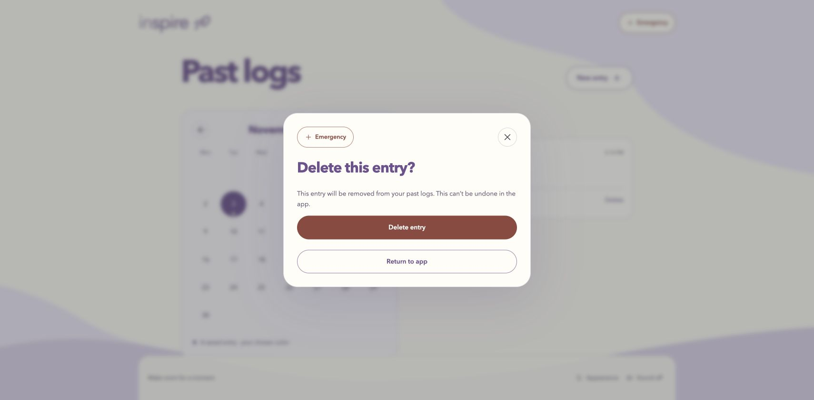

# Part 3.3 browser follow-through — November 3, 2026

This follows the [mocked evaluation](part33-evaluation.md). The user authorized
browser checks for S01, S02, S10, S14, S18 and Emergency, with live-model work
deferred. Actual Chrome UI was operated through Codex Computer Use against the
current production build at `http://127.0.0.1:8033/`.

**Outcome:** S01, S10 and S14 now have passing browser observations. S18 exposed
an inaccessible sound control in the emotion-deletion dialog, subsequently fixed
and verified in the [follow-up below](#s18-follow-up--fixed-and-verified). S02's full-duration
measurement remains blocked by the tool's maximum 30-second held input, below the
63-second planned sequence. Emergency opened in every state actually exercised,
including after the backend was stopped and the cached shell reloaded. No live
provider call, microphone capture or telephone action occurred.

## Setup and provenance

- Same application commit as the automated pass:
  `69e8c09b8861267d34c0d15f4afd56bfc2dc6119`. Runtime application files were unchanged.
  The existing build from that pass was used; it was not modified for browser tests.
- Chrome on macOS, ordinary desktop viewport; screenshot dimensions 1710 × 843.
  The exact Chrome version was not recorded. No mobile or assistive-technology
  coverage is claimed. The task-created tab was closed afterward.
- New repeatable fixture: [serve_part33_evaluation.py](../scripts/serve_part33_evaluation.py).
  It binds only localhost, sets fictional process credentials/models, disables
  retrieval, replaces text/title/summary providers and rejects outgoing HTTP.
  It never loads `.env`. Voice/transcription are unavailable and were not selected.
- Fictional SQLite and test controls live under ignored `tmp/part33-browser/`.
  No existing personal database was inspected or changed. All source text in the
  exported rows is invented for the evaluation. Deletion confirmations were
  opened, but no final Delete action was taken.
- The server's initial sandbox bind was denied. An approved escalation started
  PID 2616 on port 8033. Stopping that same process also needed escalation; it
  exited cleanly. No other server or browser tab was stopped.
- Native accessibility snapshots sometimes lagged immediately after navigation.
  Subsequent checks use DOM snapshots and confirmed dialog headings. Several
  timing-sensitive waits expired even when their diagnostics reported a visible
  heading. These are recorded as tool limitations, not application failures.

## Evidence

- [Browser observations](evidence/part33/2026-11-03-browser/observations.json):
  timestamped snapshots, DOM measurements and selected tool diagnostics.
- [Fixture request log](evidence/part33/2026-11-03-browser/requests.jsonl):
  27 API requests, three fixed-reply mock invocations, one mock title, one mock
  summary, three injected memory failures, and server start/stop records.
  Zero outgoing-HTTP tripwire events; no real provider implementation was used.
- [SQLite observations](evidence/part33/2026-11-03-browser/database-observations.json):
  read-only SQL and matching fictional emotion, breathing and chat rows.
- [Run metadata](evidence/part33/2026-11-03-browser/run.json) and
  [artifact hashes](evidence/part33/2026-11-03-browser/manifest.json).

Screenshots are the tool's original JPEG bytes, with `.jpg` extensions. They are
not generated or edited illustrations. Full snapshots and intermediate attempts
are retained; the selected evidence below identifies which observations support
each conclusion. Screenshots and snapshots are observations at discrete moments,
not a recording of continuous timing.

## Five scenario results

### S01 — Blank-note emotion entry: pass

From Home, opened Emotion log, selected Sage, tapped the graph center and used
Right/Down arrow keys. Left both optional text fields empty, then saved. The page
showed “Entry saved.” History showed pleasantness 5 and energy −5; the same entry
remained after reload.

SQLite contains color `#8fa98d`, pleasantness `5`, energy `-5`, empty `note` and
`color_meaning`. Stored `feeling: 0` is the documented absence marker, not an
inferred emotion; see [emotion contract](../backend/app/features/emotion/CONTRACT.md).
This browser input differs from the original automated 20/−30 fixture and is
reported explicitly. Existing automated tests retain drag/legacy-label coverage;
no new physical-device drag usability claim is made.

Evidence: [blank fields and graph](evidence/part33/2026-11-03-browser/08-emotion-blank-notes.txt),
[saved](evidence/part33/2026-11-03-browser/09-emotion-saved-blank.jpg),
[history after reload](evidence/part33/2026-11-03-browser/12-emotion-history-reloaded.jpg),
and the emotion row in the SQL artifact.

### S02 — Full breathing duration: partial, tool-blocked

Home → Guided breathing worked directly without an emotion prerequisite. The
control-call interval from clicking the Home option to observing the instruction
was **81ms**, including tool overhead; it is not a precise paint/first-visible
measurement or human setup study.

Attempting a 64,000ms hold was rejected before input with:
`durationMs must be an integer from 0 to 30000 milliseconds.` We did not shorten
the exercise, change its clock, inject a fake completed record, or splice separate
holds into a purported full run.

A 25-second physical pointer hold ended normally on release. SQLite recorded
**25.009s sequence, 22.009s active breathing, 0s pause, status ended**. Its
instruction-to-end was **76.6026s**, including the substantial tool/setup delay
after first instructions appeared. This is an interrupted run, not a completed
exercise and not evidence that a complete exercise meets 90 seconds. All eight
browser-created breathing records are `ended`; none claims completion.

The existing simulated 63-second completion remains automated evidence only.
TODO: a person should hold through the complete sequence in the target browser,
record first instruction → final planned step including app delay, and report
entry/setup and chosen pauses separately. Completed-screen Emergency also remains
unobserved in this browser pass.

Evidence: [early-end screen](evidence/part33/2026-11-03-browser/19-breathing-after-25s-hold.jpg),
[session history](evidence/part33/2026-11-03-browser/40-session-history-loaded.jpg),
SQL artifact and `breathing-entry` in observations.

### S10 — Interruptions and Emergency: pass in observed browser paths

Verified early release, countdown interruption, and Pause during the first inhale.
The paused screen showed “Take your time,” “Timer paused” and explicit Resume.
Opening Emergency while paused changed the exercise to ended. Closing Emergency
left the ending screen and Return home; it did not resume.

A separate observed running state showed “Breathe in.” Opening Emergency from
that state ended and saved the exercise. The native pointer was still held while
Pause/Emergency were activated with Enter, so this was not merely clicking another
button after releasing the hold. Countdown Emergency also ended the exercise.

For save failure, the fixture returned 503 on three session PUTs. The page showed
“This session hasn’t been saved” and Retry session save; Emergency still opened.
After removing the fixture fault, all three IDs were retried successfully with
201 responses and appeared once in SQLite. This was separate from any model task.

Evidence: [countdown](evidence/part33/2026-11-03-browser/21-countdown-visible.jpg),
[paused](evidence/part33/2026-11-03-browser/23-breathing-paused.jpg),
[paused Emergency](evidence/part33/2026-11-03-browser/24-paused-breathing-emergency.jpg),
[no resume](evidence/part33/2026-11-03-browser/25-after-emergency-no-resume.txt),
[countdown Emergency](evidence/part33/2026-11-03-browser/26-countdown-emergency.jpg),
[running before Emergency](evidence/part33/2026-11-03-browser/36-running-before-emergency.txt),
[running Emergency](evidence/part33/2026-11-03-browser/37-running-emergency.jpg),
[save failure](evidence/part33/2026-11-03-browser/27-interruption-attempt-result.jpg),
and [Emergency after save failure](evidence/part33/2026-11-03-browser/28-save-failure-emergency.jpg).

### S14 — Memory failure: pass

Opened Personal memory, explicitly enabled saved-conversation text in this
fictional database, and made the fixture's memory selection raise an SQL error.
Sent: “Fictional evaluation: my imaginary exam is next week.” The labeled fixed
reply appeared alongside **“Personal memory Unavailable · chat continues without
it.”** The reply was saved. Emergency opened while that notice was present.

The fixture logged `memory_present:false` for the reply; SQL contains exactly the
completed fictional pair. The unavailable notice is application behavior. No
generated recall or actual model response was evaluated.

Evidence: [reply and unavailable notice](evidence/part33/2026-11-03-browser/46-memory-failure-reply.jpg),
[Emergency](evidence/part33/2026-11-03-browser/47-memory-failure-emergency.txt),
request log and SQL artifact.

### S18 — Reduced motion and sound: failed overlay requirement

Passing observations:

- Reduced motion and Sound off survived reload; DOM class was `app reduce-motion`.
- During an actual inhale, the circle had `data-scale="1.000"` and identity
  transform, with “Breathe in” and “Let the words carry the pace.” This is a
  sampled static cue, not continuous video or an exhale observation.
- The sound control worked in Appearance and Emergency. In Emergency, it changed
  off → on → off. Its top-left position matched the footer at `(1315, 774.5)`
  CSS pixels in this viewport. There was no microphone or assistant playback.

**Failure:** Opening the emotion-history “Delete this entry?” native dialog left
Sound off behind the modal. DOM inspection found the sound button outside any
active modal; hit-testing its center returned the dialog/backdrop. Attempting to
activate that background sound button dismissed the dialog instead of toggling
sound; the label remained “Enable app sounds” and there were then zero open
dialogs. Emergency inside the deletion dialog still worked.

The existing component mocks covered shared sound state and the app-level
Appearance/Emergency sheets, but did not establish interaction through this
feature-owned native dialog. No runtime fix was made during this initial pass.
The subsequent authorized fix and its separate verification are recorded below;
the original failure evidence is retained. Real speaker quality and exhaustive
motion/accessibility testing remain unverified.

Evidence: [deletion dialog](evidence/part33/2026-11-03-browser/13-emotion-delete-confirmation.jpg),
[post-click unchanged sound](evidence/part33/2026-11-03-browser/15-delete-sound-click-result.txt),
`emotion-delete-sound-hit-test` / `delete-sound-click-outcome` in observations,
[static inhale](evidence/part33/2026-11-03-browser/22-inhale-reduced-motion.jpg),
[Emergency Sound on](evidence/part33/2026-11-03-browser/60-emergency-sound-on.txt),
and [Sound off](evidence/part33/2026-11-03-browser/61-emergency-sound-off.txt).



## B1 — Emergency access sweep

Every listed action opened the resource panel with distinct crisis-counseling and
emergency-services descriptions and a return control. **No call link was selected.**
Resource content is bundled application UI, not a response produced by the mock.

| Observed starting state | Evidence snapshot |
| --- | --- |
| Home | [01](evidence/part33/2026-11-03-browser/01-home-emergency.txt) |
| Appearance modal | [04](evidence/part33/2026-11-03-browser/04-appearance-emergency.txt) |
| Emotion form | [07](evidence/part33/2026-11-03-browser/07-emotion-emergency.txt) |
| Emotion history | [11](evidence/part33/2026-11-03-browser/11-emotion-history-emergency.txt) |
| Emotion deletion modal | [14](evidence/part33/2026-11-03-browser/14-emotion-delete-emergency.txt) |
| Breathing ended | [20](evidence/part33/2026-11-03-browser/20-ended-breathing-emergency.txt) |
| Breathing paused | [24](evidence/part33/2026-11-03-browser/24-paused-breathing-emergency.txt) |
| Breathing countdown | [26](evidence/part33/2026-11-03-browser/26-countdown-emergency.txt) |
| Failed breathing save | [28](evidence/part33/2026-11-03-browser/28-save-failure-emergency.txt) |
| Running breathing | [37](evidence/part33/2026-11-03-browser/37-running-emergency.txt) |
| Breathing session history | [41](evidence/part33/2026-11-03-browser/41-session-history-emergency.txt) |
| Chat with Personal memory controls expanded | [45](evidence/part33/2026-11-03-browser/45-memory-controls-emergency.txt) |
| Chat with memory unavailable | [47](evidence/part33/2026-11-03-browser/47-memory-failure-emergency.txt) |
| Chat after mocked reply failure | [49](evidence/part33/2026-11-03-browser/49-model-failure-emergency.txt) |
| Chat during pending reply | [51](evidence/part33/2026-11-03-browser/51-pending-reply-emergency.txt) |
| Saved-chat list | [54](evidence/part33/2026-11-03-browser/54-chat-history-emergency.txt) |
| Saved-chat detail with inline deletion confirmation | [57](evidence/part33/2026-11-03-browser/57-chat-deletion-emergency.txt) |
| Saved-history request failure | [59](evidence/part33/2026-11-03-browser/59-history-failure-emergency.txt) |
| Loaded Home after fixture server stopped | [63](evidence/part33/2026-11-03-browser/63-server-stopped-emergency.txt) |
| Cached-shell reload with server still stopped | [64](evidence/part33/2026-11-03-browser/64-offline-reloaded-emergency.txt) |

For the pending reply, `demo:slow` invoked a 15-second fixed provider delay. Opening
Emergency restored the draft and marked the submitted bubble unavailable. End chat
returned Home immediately. Saved history subsequently contained only the original
successful pair. The late backend completion did not create a saved turn. This
does not claim provider-side cancellation: the mock work finished with HTTP 200
after approximately 15 seconds, as the log shows.

**Coverage limit:** B1 passes for these 20 observed starting states, but is not
exhaustively verified for every possible state. Full breathing completion and
actual voice/microphone/autoplay states remain untested in this browser run. The
offline reload used an already-cached production shell; first-ever offline loading
is not established. There is no evidence here of live crisis-response quality.

## Repeating the fixture

With an existing production build, run in a task-owned terminal from the root:

```sh
backend/.venv/bin/python scripts/serve_part33_evaluation.py --port 8033 --directory tmp/part33-browser-next
```

Open localhost port 8033 in a new task tab. The fresh directory keeps prior evidence
and test data separate. The fixture creates `control.json`; change only that
task-owned file to `{"memory_failure":true}`, `{"save_failure":true}` or
`{"history_failure":true}` for the corresponding fault, and `{}` to recover.
Use `demo:fail` / `demo:slow` only in this mocked fixture. Do not select Voice mode,
dictation or telephone links. Stop only the server started for this test.

Commands used: project Python fixture startup; approved `kill -INT 2616`; Python
read-only SQLite export and evidence hashing; `py_compile`; `git diff --check`.
UI actions/snapshots/screenshots used only Computer Use. No dependencies, runtime
feature changes, model calls, real microphones, staging, commits or pushes. The
earlier automated suites were not rerun because application/test code did not
change; their prior logs are retained rather than labeled as new browser evidence.


## S18 follow-up — fixed and verified

The user subsequently authorized a fix, regression test and evaluation update.
This follow-up used the rebuilt production app at `http://127.0.0.1:8034/`, the
same mocked-provider fixture, and a fresh fictional database under
`tmp/part33-sound-fix/`. It did not repeat the original 20-state Emergency sweep.

**Change:** shared `ModalSheet.vue` now includes the shared sound control by
default, positioned from the footer anchor. `App.vue` provides that anchor and a
mounted-dialog count, hiding the background footer control until all dialogs have
closed. Nested Emergency therefore owns the active sound control while the
underlying deletion dialog is inert. All controls use the same sound preference.
No feature-owned imports, endpoint, dependency or checkpoint manifest changed.

| Check | Expected | Observed |
| --- | --- | --- |
| Deletion dialog | Sound accessible at footer position; toggling does not close or delete. | One sound button was inside the active native dialog; center hit-test reached that button. Top-left matched the footer at (1315, 774.5) CSS px. Click changed off → on and the deletion dialog remained open. |
| Nested Emergency | Emergency opens; topmost sound toggles the shared state; returning preserves the deletion dialog. | Both native dialogs were open. Only the top Emergency sound received center hit-tests. Clicking changed both labels to off. Closing Emergency restored the deletion dialog and its working sound control. No call link selected. |
| Keyboard and cleanup | Enter toggles sound; closing restores footer and original focus. | Enter changed deletion sound off → on without closing. Close returned focus to Delete and restored one footer sound button. |
| Appearance and reload | Existing Appearance control works; mute persists; entry remains. | Appearance changed on → off; reload retained Sound off and the fictional entry. Reopened deletion dialog showed Sound off. No DELETE request occurred; read-only SQL retained exactly one row. |
| Regression test | Default dialog slot must suffice; nested state, placement and lifecycle stay correct. | Real ModalSheet and SoundToggle templates rendered in a fake host. Toggle, bubbling, no deletion, nested Emergency, resized anchor, modal count, focus cleanup and resize-listener removal assertions passed. This is component evidence, separate from native browser hit-testing. |

Evidence: [click result](evidence/part33/2026-11-03-sound-fix/06-delete-sound-on.jpg),
[nested Emergency](evidence/part33/2026-11-03-sound-fix/07-nested-emergency.jpg),
[keyboard result](evidence/part33/2026-11-03-sound-fix/10-deletion-keyboard-toggle.txt),
[reload](evidence/part33/2026-11-03-sound-fix/14-reload-muted.txt),
[reopened dialog](evidence/part33/2026-11-03-sound-fix/15-reopened-deletion.jpg),
[timestamped observations](evidence/part33/2026-11-03-sound-fix/observations.json),
[requests](evidence/part33/2026-11-03-sound-fix/requests.jsonl),
[SQL](evidence/part33/2026-11-03-sound-fix/database-observations.json),
[run/source hashes](evidence/part33/2026-11-03-sound-fix/run.json),
and [artifact manifest](evidence/part33/2026-11-03-sound-fix/manifest.json).

Commands/checks: `node --test tests/modal-sound.test.js` passed; `npm test` passed
141/141 frontend tests; `npm run build` passed; non-mutating `npm exec --offline --
oxlint .` and `npm exec --offline -- eslint . --no-cache` passed. Project Python
`scripts/verify_checkpoints.py` passed interface (11 frontend tests), emotion
(14 frontend/8 backend) and breathing (30 frontend/10 backend), with their lint
and build checks. See archived command/status files and outputs in the evidence
directory. Existing large-chunk and Starlette/httpx warnings remain. Full backend
and memory suites were not rerun for this frontend-only change; their earlier
350/26 results retain their original dates/provenance.

The task-owned fixture PID 12724 stopped cleanly using `kill -INT 12724`; the
created tab was closed. Its three API requests were one emotion PUT and two GETs;
zero DELETEs, provider mock invocations or outgoing-HTTP tripwire events. Browser
console capture contained no warnings/errors. No live calls, microphone, speaker
quality test, telephone action, real data deletion, dependency, commit or push.
S18 passes within this observed scope. S02 full-duration timing, broader device/
accessibility coverage, generated output variation and peer testing remain open.
