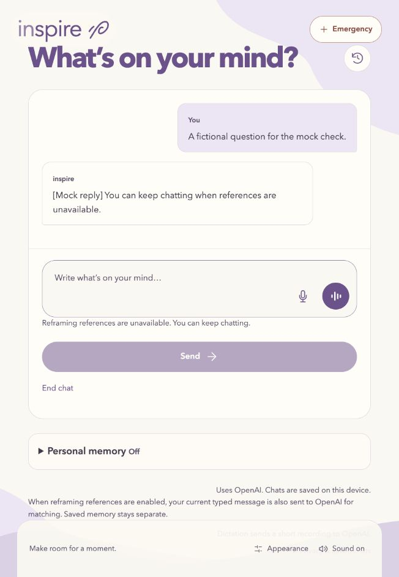

# Reframing implementation evidence

Later voice startup access and conversational-delivery changes are recorded in
[conversation/voice verification](reframing-conversation-verification.md). The
checkpoint history below describes the earlier typed integration milestone.

Final status (November 3): checkpoints 1–6 completed with the limitations below.
The local ignored configuration selects the real index and low typed reasoning;
restart the backend to load it. Code defaults remain off. No dynamic spoken
retrieval was added. Historical failed observations are retained below.

| Checkpoint | Reproducible evidence | Result |
| --- | --- | --- |
| 1. Composition/disconnect | Backend boundary and `test_disconnect_after_memory_selection_prevents_generation` tests | Passed |
| 2. Bounded lookup | `reframing/tests/test_async_lookup.py` | Passed |
| 3. Typed integration | `reframing/tests/test_integration.py`, frontend chat tests, original cumulative builds | Passed |
| 4. Combined fictional software cases | `reframing-mocked-evaluation.json`; 26 personal-memory scenarios | Passed |
| 5. Real vectors/relevance | `reframing-real-index.json`, `reframing-relevance-evaluation.json` | 76 documents; 7/8 positive hits, 6/6 negative no-matches |
| 6. Generated reply/latency sample | `reframing-low-reasoning-evaluation.json` and configuration check | 3/3 sample observations passed after the recorded timeout experiment |

Only observed checks are recorded below. Mocked transport/synthetic vectors establish software behavior, not semantic relevance or generated replies. Checkpoints 1–4 used no paid calls. Later sections record the separately authorized live work. No microphone checks were performed.

## Checkpoint 1 — composition and disconnect repair: passed

Command: `backend/.venv/bin/python -m pytest backend -q`

Observed: **307 passed**, one existing Starlette/httpx deprecation warning (2026-11-03). The strengthened relative-import boundary check passes. A disconnect after memory selection produces HTTP 409 and zero provider calls; a disconnect during voice creation still closes the late session. Shared JSON, memory scope and provider exceptions now live outside sibling features. Memory summary policy is injected at composition. Existing memory/summary/storage tests pass.

Local detailed output: `tmp/reframing-implementation/phase1-tests.txt` (not a committed artifact).

Handoff ignore rules cover `/handoffs/` and `/docs/*handoff*.md`. An already tracked file requires removal from the Git index to become ignored; local content is preserved.

## Checkpoint 2 — aligned, bounded retrieval: passed

Command: `backend/.venv/bin/python -m pytest backend -q`

Observed: **313 passed**, one existing warning. A complete 8,000-byte multilingual message reaches the mocked embedding adapter, including its final correction. Missing/invalid indexes make zero embedding calls. The API now names its gate `allow_reference_lookup`; it does not represent conversational consent. Typed personal data has a structured policy/data envelope; voice retains its startup snapshot interface. Event-controlled tests observe two actual workers after caller timeout, reject a third lookup without queuing, and propagate cancellation without freeing an occupied worker. Late reference results are discarded. No network or semantic relevance claim.

Local detailed output: `tmp/reframing-implementation/phase2-tests.txt`.

## Checkpoint 3 — typed integration: passed

Commands: `backend/.venv/bin/python -m pytest backend -q` (**323 passed**),
`cd frontend && npm test` (**138 passed**), `npm exec --offline -- oxlint src tests pwa vite.config.js eslint.config.js`,
`npm exec --offline -- eslint . --no-cache`, `npm run build` (all passed).
`backend/.venv/bin/python scripts/verify_checkpoints.py` also passed every original
cumulative scope without changing the manifest; results are in
`.checkpoints/20261103-084529-192434/results.json` locally.

Observed: real SQLite + synthetic lookup + mocked reply preserve personal opt-ins,
separate policy/data input and embed only the current message. Retrieval failure
preserves permitted facts and one ordinary reply. Browser-supplied references/model/
threshold fields are rejected before calls. Repeated storage PUT makes zero
embedding/reply calls. Frontend tests preserve the usable reply on reference failure,
clear the status on a later reply, and reject late replies/references after Emergency
interruption without overwriting a new draft. No new dependencies or voice retrieval.
Existing Starlette deprecation and Vite large-bundle warnings remain.

Local detailed outputs: `tmp/reframing-implementation/phase3-{tests,frontend-tests,build}.txt`
and `original-checkpoints.txt`. No live relevance or generated behavior claimed.

## Checkpoint 4 — combined mocked evaluation: passed

Command: `backend/.venv/bin/python -m pytest backend -q`: **341 passed**, one existing
warning. Fifteen parameterized fictional transport/source cases passed. Observed
records: [reframing-mocked-evaluation.json](reframing-mocked-evaluation.json).

Additional command: `backend/.venv/bin/python scripts/evaluate_personal_memory.py --output tmp/reframing-implementation/personal-memory-regression.json`:
**26 scenarios passed, zero failed**, six local benchmark groups. The evaluation's
mock now reads the structured typed personal-data envelope; voice still receives
its original string snapshot. Source selection/permissions were not changed.

Observed: optional deadline falls back while the worker is still running; releasing
it causes no second generation or late context. Disconnect after lookup starts no
reply. A blocked summary task does not prevent retrieval/reply, and its input excludes
assistant suggestions. The scenarios' `reframe_requested` field is an evaluation
annotation, not a runtime classifier. Enabled v1 can look up optional references
on listening/refusal/stop inputs; mocks do not establish the generated response's
appropriateness. This limitation is explicit instead of claiming a boolean gate
understands language. Independent Emergency and UI cancellation remain immediate.

Local output: `tmp/reframing-implementation/phase4-tests.txt` and
`personal-memory-regression.{json,txt}`. Live relevance/replies are the next gate.

## Checkpoint 5 — real index and relevance: passed with a recorded miss

The user explicitly authorized at most six embedding requests and three fictional
reply requests. Five real `text-embedding-3-small` requests (1536 dimensions) built
76 document vectors; the sixth embedded the fifteen fictional queries together.
No retries, personal records, audio or extra model tasks. The immutable local index
`backend/data/reframing-2026-11-03.sqlite3` passes complete corpus/model/dimension/
document-hash validation. Real metadata/timings: [reframing-real-index.json](reframing-real-index.json).

Observed relevance and threshold comparison: [reframing-relevance-evaluation.json](reframing-relevance-evaluation.json).
At 0.45, **7/8** positive cases retain an acceptable family and **6/6** negative
cases return no match. The competing-priorities case is a measured miss: its best
acceptable score is 0.392716. Lower thresholds recover it but can supply an unwanted
candidate for the correction case. Ordinary chat can answer without a card. This
small development set does not establish held-out performance or intent detection.
The failure scenario's real vector was also checked in its healthy form; failure
fallback remains the separately observed mocked test. Batch query HTTP took 1054.86ms;
this is not a per-turn latency distribution.

Build/query runner: local `tmp/reframing-implementation/live.py`; no key in commands,
reports or logs. Vectors/exports/request ledger are ignored under the feature's
`private/` directory. The app remains disabled pending the generated sample gate.

## Checkpoint 6 — live fictional replies: incomplete; activation held

Three authorized reply requests used the existing configured `gpt-6-luna` model.
Real query vectors from checkpoint 5 were replayed, avoiding additional embedding
calls. Two returned HTTP 200: a grounded requested perspective (4999.31ms) and a
brief acknowledgment of refusal without a question or persuasion (8982.29ms).
The stop case hit the existing ten-second socket timeout (HTTP 504, 10202.19ms).
The UI timeout/error/draft path is covered by mocks, but the generated closing was
not observed. No retry, model switch or timeout increase was performed. The sample
budget is exhausted; this gate is explicitly incomplete. See
[reframing-live-reply-evaluation.json](reframing-live-reply-evaluation.json).

No runtime activation or spoken-retrieval work follows this failed gate. Three
samples would not establish general generated behavior even if all returned.
The observed route times exclude a new embedding round trip and cannot establish
a full per-turn latency distribution. Two-second lookup fallback and the browser's
existing 15s request timeout remain unchanged.

The user separately authorized one additional identical stop request. It also
returned HTTP 504 after 10220.39ms; no closing reply was observed. Total authorized
usage consumed: **six embedding requests and four reply requests**. The additional
observation is [reframing-live-stop-repeat.json](reframing-live-stop-repeat.json).
No further paid work is authorized by those exhausted caps. Current activation
remains held. A possible next experiment is an explicit server-owned typed
reasoning effort of `low`, evaluated before adoption. It is an inference about a
latency tradeoff, not a diagnosed cause of the timeouts. Official basis:
[GPT-6 Luna](https://developers.openai.com/api/docs/models/gpt-6-luna) and
[deployment guidance](https://developers.openai.com/api/docs/guides/deployment-checklist).

Final regression at this point: **341 backend tests, 138 frontend tests**, oxlint,
ESLint, frontend build and `git diff --check` pass. Original cumulative scopes
passed earlier; their manifest remains byte-for-byte unchanged. Handoff content
is retained locally and ignored; the previously tracked `handoffs/current.md`
was removed from the index only. No commit, dependency change, microphone, runtime
activation or spoken-retrieval work was performed.

## Browser fallback observation (mock only)

A temporary localhost server on port 8027 used a fixed labeled reply, a forced
unavailable technique report, a separate fictional database, and blocked outgoing
HTTP connections. Browser observation: Support chat opens directly from Home;
the mocked reply and nonblocking unavailable notice appear together; Emergency
opens independently; returning preserves the chat; End chat returns Home. No call
links, microphone, dictation or provider API was used. The temporary tab/server
were closed; only the process started for this check was stopped.

## Authorized low-reasoning experiment — software gate passed

After the identical stop timeout repeated, the user explicitly approved an optional
server-only low-reasoning setting and at most three additional fictional replies.
`CHAT_REASONING_EFFORT=low` changes typed Responses only. Unset/other values retain
the provider default; browser fields remain forbidden. Voice delegation, summaries,
titles, model choice, fixed timeouts and retries are unchanged. Mocked payload and
request-rejection tests pass: **343 backend tests**. The real sample is a separate
observation, not inferred from this payload check.

## Low-reasoning live gate and final configuration — passed sample

Observed with the same configured `gpt-6-luna` model and explicit low typed
reasoning: requested perspective, refusal and closing all returned HTTP 200.
Elapsed route times were **2365.30ms, 1402.14ms and 2131.80ms**. The perspective
kept the event and one tentative alternative/question; refusal and closing were
brief acknowledgments without questions or persuasion. The closing did not claim
application-owned actions. [Observed sample](reframing-low-reasoning-evaluation.json).
The earlier default-effort timeouts remain documented; this small sample suggests
a useful latency improvement, not a proven cause or universal guarantee.

Total authorized and consumed API requests: **six embeddings, seven replies**
(initial three + explicitly authorized repeat + explicitly authorized three low
effort samples). No extra embedding, summary, title or microphone tasks. Query
vectors in reply checks were replayed from the real batch, so route timings do not
include a fresh embedding HTTP round trip. No held-out relevance or full production
latency distribution was established. The competing-priorities miss remains.

The ignored local `.env` now explicitly selects the evaluated index/model/dimension/
threshold, enables typed retrieval and uses `CHAT_REASONING_EFFORT=low`. This makes
matching available on future user-initiated typed turns after a backend restart;
no extra provider call was made while configuring it. Existing processes were not
stopped or restarted. Default source-code behavior remains off; set the local flag
to `0` and restart to roll back. Read-only zero-network configuration verification:
[reframing-configuration-check.json](reframing-configuration-check.json).

Routine backend tests now explicitly isolate enabled lookup/typed-effort environment
settings and reject outgoing HTTP globally. A locally enabled app configuration
cannot silently turn routine tests into paid checks. Approved live scripts remain
separate from pytest. No dependencies were added. The original checkpoint manifest
is unchanged; only the tracked handoff removal is staged, and no commit was made.

## Final checks

Final observed totals: **343 backend tests passed; 138 frontend tests passed**;
oxlint, ESLint, frontend production build, `git diff --check`, all original cumulative
checkpoint builds and the personal-memory evaluation's **26 scenarios** passed.
The memory evaluation was repeated after the approved typed-setting change and
passed again; six benchmark groups completed without memory fallback. Existing
Starlette/httpx deprecation and Vite large-bundle warnings remain. No new code
changes followed these checks. The local configuration check made zero external
requests. The temporary browser mock server/tab were stopped/closed.

Changed-file groups: `.gitignore`; neutral backend `context_contracts.py`,
`context_data.py`, `conversation_context.py`, `json_http.py`, `provider_errors.py`;
`features/reframing/` corpus/index/service/configuration/async lookup/tests/contracts;
personal-memory preparation/registration/shared imports/contracts and its typed
integration assertion; voice registration/routes/provider/prompts/settings/schemas/
shared imports/contracts/tests; `main.py` composition/lifecycle;
`backend/tests/test_boundaries.py` and `backend/conftest.py`; frontend chat
`useChat.js`, `ChatView.vue`, chat tests; `scripts/reframing_kb.py` and the structured
mock adapter in `scripts/evaluate_personal_memory.py`; README, AI-USE, chat-policy,
evidence and reframing documentation/JSON/screenshot artifacts. The ignored `.env`
and handoffs have local configuration/context updates. Original Part 3.1 report
and checkpoint manifest were preserved. The Git index contains only the requested
handoff untracking; implementation changes remain uncommitted.
