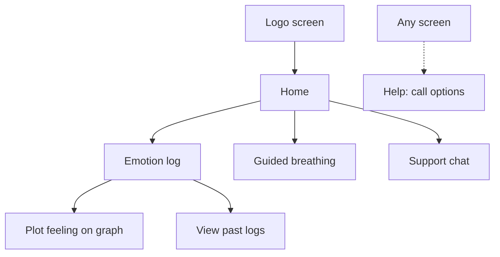

# Assignment 3 Part 1 — Research and Design

## Scope and project access

I'm planning to make a phone-based mental health skills app with a warm, soft page. The imagined user is someone struggling with anxiety, intrusive thoughts, and other mental health issues who needs basic support but can't pay for a therapist or is afraid to do so. This will remain a localhost coursework prototype tested with fictional scenarios.

A blank screen with a logo block fades into the home screen, with three wide buttons stacked vertically: Emotion log, Guided breathing, and Support chat. These are separate options the user can pick, allowing them to control their own journey.

The emotion log says, “Hi, how are you feeling today?” with a ChatGPT voice-mode-style bubble, a feeling slider, circular color choices, and an optional “Tell me about it” text box. The bubble is just visual. The user assigns meaning to the color, giving them a nonverbal way to express their emotions. A separate page lets them plot a point on a graph: unpleasant to pleasant horizontally, low energy to high energy vertically. Feeling, color, and graph plotting are required to save; the user can leave without saving. Past logs appear as colored circles on a calendar. Selecting a day shows its entries, which can be edited or deleted.

For breathing, a circle expands for breathing in and shrinks for breathing out, with numbers showing the count. I'm taking inspiration from Headspace and Apple Watch. After a 3–2–1 countdown, the initial pattern is four seconds in and six seconds out, repeated six times. Pause, End exercise, and Help stay accessible. Other patterns can come later.

Chat should be simple, soft, and open-ended, using CBT techniques and NLP-style cognitive reframe patterns: the fourteen patterns in Robert Dilts's *Sleight of Mouth* and Doug O'Brien's *The User's Guide to Sleight of Mouth*, based on modeling Richard Bandler's responses. [Dilts](https://www.nlpu.com/NLPU_RBDPubs.html), [O'Brien](https://www.sleightofmouth.org/). The system prompt will request low-stimulus, nonjudgmental language and permission architecture. Reply settings could change intensity or assertiveness. End chat stays visible; there is no forced ninety-second conversation timer.

Help is accessible throughout, opening U.S. crisis-counseling and emergency-services call options independently of the model or request failures. Coursework demonstrations simulate calls.

The planned stack is Vue, FastAPI, Python, and SQLite, saving logs, conversations, skill sessions, and preferences for history and personalization. Earlier logs only become chat context when the user chooses them. My original vector-database idea is deferred; the provider and external data flow still need to be resolved.

Repository: [mental-health-app](https://github.com/jclee2044/mental-health-app.git)

Submitted version: [084981b0d18982257ee70371200c700fd6ba650c](https://github.com/jclee2044/mental-health-app/commit/084981b0d18982257ee70371200c700fd6ba650c)

Documentation: [README](https://github.com/jclee2044/mental-health-app/blob/084981b0d18982257ee70371200c700fd6ba650c/README.md), [AGENTS.md](https://github.com/jclee2044/mental-health-app/blob/084981b0d18982257ee70371200c700fd6ba650c/AGENTS.md), [design notes](https://github.com/jclee2044/mental-health-app/blob/084981b0d18982257ee70371200c700fd6ba650c/docs/design-notes.md), [research notes](https://github.com/jclee2044/mental-health-app/blob/084981b0d18982257ee70371200c700fd6ba650c/docs/research-notes.md), [evidence log](https://github.com/jclee2044/mental-health-app/blob/084981b0d18982257ee70371200c700fd6ba650c/docs/evidence-log.md), and [AI-use disclosure](https://github.com/jclee2044/mental-health-app/blob/084981b0d18982257ee70371200c700fd6ba650c/AI-USE.md). The current work is research, design, and static mockups, not implemented application behavior.

## Research notes

Twenty questions is too much to answer for most people and may lead to friction or loss of attention. Instead of asking a large number of Likert-scale questions, I want the user to plot a point on a graph representing different emotional states. This provides a more open-ended while still quantitative way to describe their emotional state. It remains self-report, rather than an objective anxiety measurement or validated replacement for STAI.

Social desirability bias may lead some people to report more positive feelings than they actually are experiencing. When reviewing the mouse-click paper, I thought we could also look at eye-tracking behavior: how often the user's eyes are darting around or how consistently they're fixed on certain points. I wondered whether more darting might indicate higher anxiety. We would need other metrics to get a cluster of behavior and establish each user's baseline. This is something to investigate, not an established detector for the app.

From an ethical standpoint, tracking would need a notice and consent explaining how it is used. I would want the data used privately in-app, rather than externally to train models. Eye tracking and behavioral baselines are not part of the starting prototype.

I also want to define outcome criteria, provide the LLM with specific documentation, and give it concrete examples from which to draw. Similarly, it's important to tailor responses and gather context stored locally to better serve the user over time.

Additional references inform the design:

- Betella and Verschure (2016), [The Affective Slider](https://journals.plos.org/plosone/article?id=10.1371/journal.pone.0148037): a precedent for brief pleasure/arousal self-report; my graph and color interface still need evaluation.
- Jonauskaite et al. (2020), [color-emotion associations](https://www.psychologicalscience.org/journals/psychological-science/0956797620948810/): shared associations and contextual differences inform my choice to let users assign color meanings.
- Balban et al. (2023), [structured respiration practices](https://pubmed.ncbi.nlm.nih.gov/36630953/): studied five-minute practices over a month, a different duration from my one-minute 4–6 exercise.
- Fitzpatrick, Darcy, and Vierhile (2017), [Woebot trial](https://mental.jmir.org/2017/2/e19/): an early example of conversational CBT delivery, involving a different system from my open-ended chat.
- The Centre for Clinical Interventions' [anxiety resources](https://www.cci.health.wa.gov.au/Resources/For-Clinicians/Anxiety) provide material on thought diaries and thinking styles. Lewis et al. (2020), [RAG](https://arxiv.org/abs/2005.11401), provides the technical basis for supplying retrieved context.

Fuller references are in the [research notes](https://github.com/jclee2044/mental-health-app/blob/084981b0d18982257ee70371200c700fd6ba650c/docs/research-notes.md). These inform the design rather than establish clinical effectiveness.

## Design considerations

I'm planning to make the app have an affective UI, with custom colors and styles tailored to the individual. Color and style can be changed by the user. I'm still not sure what an adaptive UI would entail, and I want to explore different options as I build. The starting version can remember explicit preferences without automatically deciding what the user needs.

I want to research other metrics for measuring emotional state and stress level, and create an emotional/behavioral baseline so the app can measure deviation instead of treating every user as the same. Those remain longer-term questions. I'm still ideating and planning to refine my ideas adversarially with ChatGPT as well.

The [R1–R4 and D1–D6 study findings](https://github.com/jclee2044/mental-health-app/blob/084981b0d18982257ee70371200c700fd6ba650c/docs/assignment-description.md) inform these choices:

| Finding | Design decision |
| --- | --- |
| R1: Short exercises | Sixty seconds of breathing; full planned exercise within 90 seconds. |
| R2: Frictionless crisis access | Help opens call options without chat or a questionnaire. |
| R3: Permission to stop | Leave logging, breathing, or chat without a penalty. |
| R4: User controls the journey | Three independent activities. |
| D1: Interface contraction | Adaptive UI remains an open question. |
| D2: One skill at a time | One breathing pattern per exercise. |
| D3: Minimize emotional cost | Optional text; review effort required by feeling/color/graph inputs. |
| D4: Visible safety | Help persists inside activities and failure states. |
| D5: Light personalization | Usable defaults and optional, remembered preferences. |
| D6: Low-stimulus language | Soft presentation, nonjudgmental wording, and reduced motion. |

The breathing budget is about 75 seconds including instructions, Begin, countdown, breathing, and completion. This needs measurement later. Entry/setup are reported separately; user-chosen pauses and Help time are excluded. Fixed skill steps, saved state, Help, and exits must be controlled by the application, not the system prompt alone.

## Flow diagram

The user can save after plotting their feeling, return home, or leave at any time. The calendar opens a selected day's logs. Help is available throughout.

## Early mock up

I described the flow and layout for each individual screen, including the elements it should contain and how the user would move through it. I used those descriptions with ChatGPT's image generation tool to generate the low-fidelity screen images below. They show the intended experience, not working navigation or animation.

## Open questions

- What will the affective UI actually mean or look like beyond letting the user change colors and styles? What would make it adaptive?
- How will I use other anxiety-tracking and stress-identifying mechanisms in the app? Which metrics are useful enough to investigate?
- How would I establish a baseline for each user, and distinguish a meaningful change from their normal behavior?
- If I explore eye tracking, how would I collect it reliably and explain the consent and privacy choices?
- What should the feeling slider represent, and does requiring both the slider and graph add unnecessary effort?
