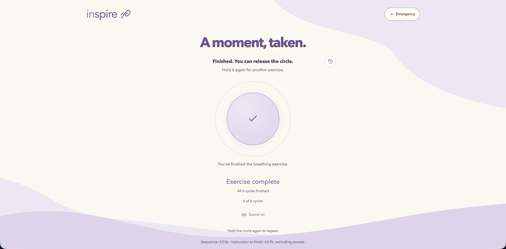
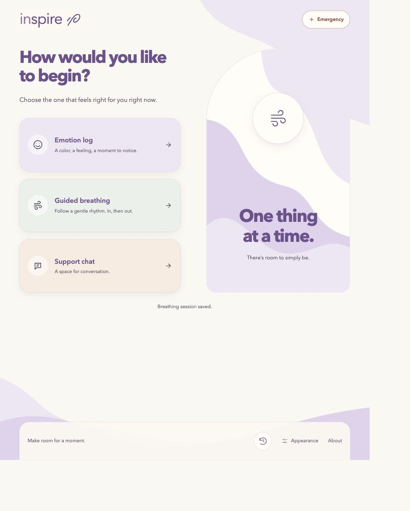
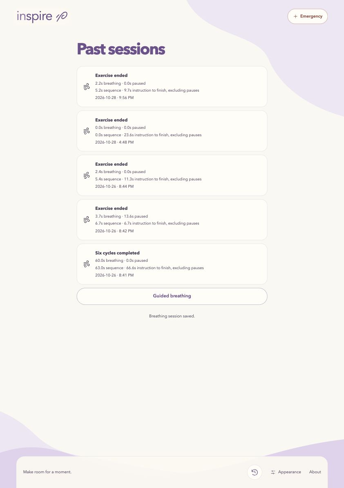
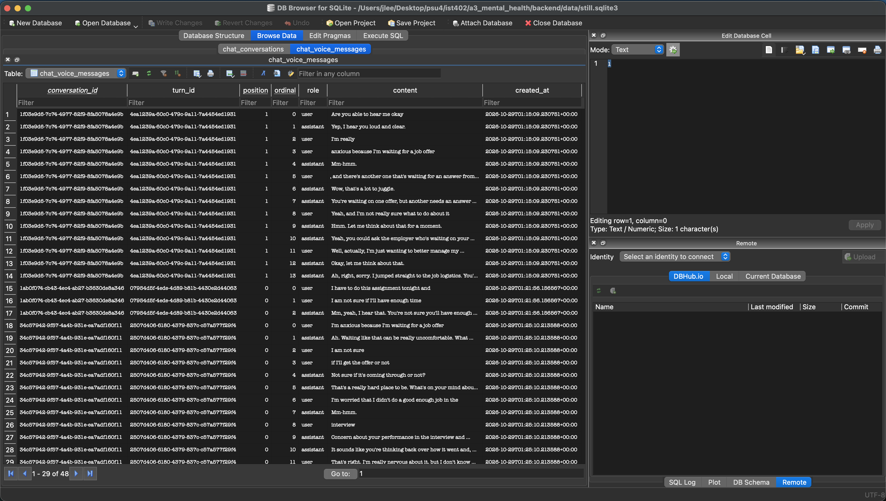
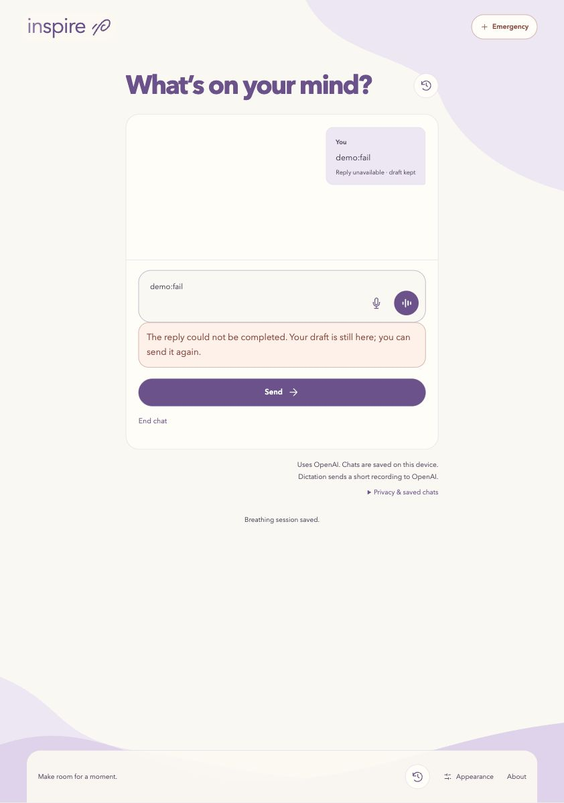
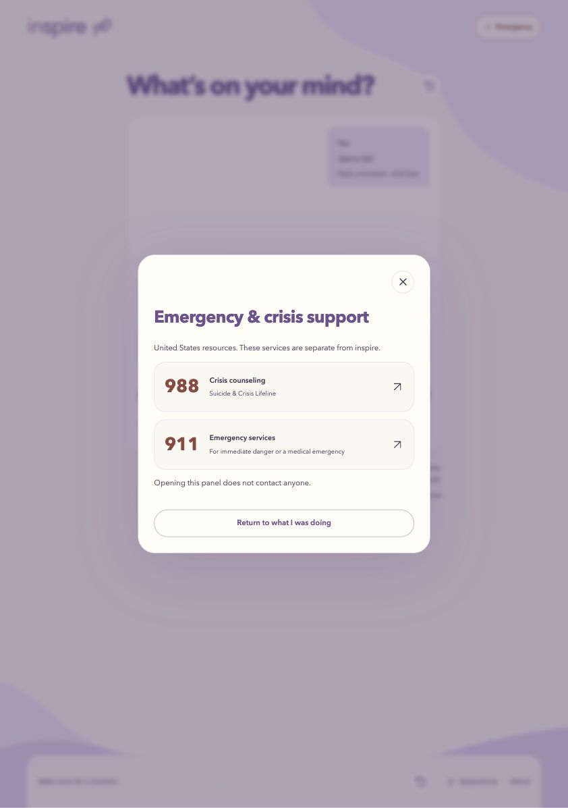

# Assignment 3 Part Two — Working Application and Safety

**Repository:** [mental-health-app](https://github.com/jclee2044/mental-health-app). **Application commit:** [9023240](https://github.com/jclee2044/mental-health-app/commit/9023240a458a25d18cded44ba4023bc3bffdd2b9).

## What is implemented

inspire is an app with an emotion log, guided breathing and a chatbot. It runs on localhost using Vue, FastAPI and SQLite. Each option is available directly from Home, so the user does not have to log an emotion before breathing or chatting. This is a coursework prototype using fictional scenarios, not therapy, diagnosis or monitoring.

The emotion log lets the user place a point on a pleasantness × energy graph, choose their own color and optionally add notes. Entries are saved and can be reviewed, edited or deleted. Color means whatever the user wants it to mean; the app does not interpret it automatically. I still have more testing that I want to do for the emotion log since I am finalizing and refining how I want the user flow to be.

Guided breathing uses a 3–2–1 countdown followed by six cycles of four seconds in and six seconds out. The user taps and holds the circle to start, and releasing early returns to Home. Sound can be muted, and reduced motion keeps text/static cues available. The application controls timing independently of requests, keeping the skill short (R1), leaving the user in control (R3/R4) and reducing effort (D2/D3).

Chat supports typed messages, voice conversation and dictation into an editable draft. The system prompt supports emotional exploration and direct answers to practical questions. Emergency, exits and the breathing sequence remain application controls. SQLite stores conversation text and breathing sessions, with saved history available for review. Audio is not saved, and historical chats are not automatically sent back to the model. Local storage does not mean model processing is fully local.

## Verification and screenshots

I tested guided breathing multiple times, including tapping and holding and then releasing early, which returns to the home page, and holding through the whole exercise, which leads to the six cycles. My completion screenshot shows **63.0 seconds for the sequence and 63.9 seconds from instruction to finish**, excluding pauses. This run is under the assignment's 90-second limit, with a prompt start and no additional user responses required. Entry/Home navigation is outside that measurement and still needs separate timing; there is no forced timeout.

A new browser check of early release returned Home and saved an `ended` session with **2.2 seconds of breathing**, rather than claiming completion. [Matching SQLite record](../../docs/evidence/part32-current-exit.json).

I also used DB Browser for SQLite to check the database and verify that the messages were being recorded there. The screenshot shows fictional spoken-text records in `chat_voice_messages`; earlier [browser/database checks](https://github.com/jclee2044/mental-health-app/blob/9023240a458a25d18cded44ba4023bc3bffdd2b9/docs/part32-verification.md) separately checked typed persistence and records surviving restart.

A mocked request failure kept the draft and showed an error. End chat remained available, and Emergency opened independently (R2/D4); no call links were selected. Earlier [save-failure evidence](https://github.com/jclee2044/mental-health-app/blob/9023240a458a25d18cded44ba4023bc3bffdd2b9/docs/evidence/part32-breathing-save-failure.png) shows the unsaved notice and Retry; it uses the previous visual design. Storage-only Retry does not repeat a model call; pending saves can be lost on reload/close.

The latest recorded automated checks passed **188 backend tests, 101 frontend tests, lint, the production build and all three original cumulative checkpoints**. New browser checks used a mocked demo and separate database, with no paid calls or microphone access. Mocks do not establish generated behavior or clinical effectiveness.

## Revisions and AI use

For voice mode, I found that it was sometimes adding a space to the beginning of messages as they were transcribed and appeared. I fixed that and found it much easier to read and a lot cleaner.

In another iteration, the echo technique was being overutilized: the chatbot was simply relaying what the user said without further probing or moving the conversation along. I revised the system prompt to always ask a relevant question after echoing or repeating words back so the user is encouraged to think more deeply. I found this flow more natural and easier to maintain. Requests to stop or have no questions take priority. These are my observations; the mocked tests do not establish how consistently the revised prompt behaves.

I explained roughly what design style I wanted and had ChatGPT ask clarifying questions and create multiple reference UIs. I gave feedback until I was satisfied, then gave that to Codex to redesign the app because the earlier design felt generic. One failed approach was describing the icon I wanted: it came out differently than expected, so I used Codex's sketch functionality to draw what I envisioned, which produced a much closer result.

I used **Codex with GPT-6.1 Sol**, along with ChatGPT for research, design references and writing support. Image-generation model/version details were not recorded. [AI-USE.md](../../AI-USE.md) identifies tools, roles and available model identifiers; the [curated prompt and evidence log](../../docs/part32-evidence.md) connects selected prompts, revisions, observations and decisions. The app's model configuration is disclosed separately from the coding model.

## What I still want to add

I still want to implement cognitive reframing using NLP reframe patterns, including the fourteen patterns discussed in Robert Dilts's *Sleight of Mouth* and Doug O'Brien's *The User's Guide to Sleight of Mouth*. These remain proposed influences requiring review, not established CBT evidence or clinically validated techniques. A guided reframe still needs the assignment's fixed steps, exits and timing checks.

I also want to finish the dynamic UI. After the redesign it currently uses a fixed style and color palette, which I want to change for the final version. Eye tracking is another feature I wanted to try; it is not implemented. Saved-history personalization, retrieval, broader accessibility checks and the Part 3.3 evaluation remain unfinished.

The [design notes](https://github.com/jclee2044/mental-health-app/blob/9023240a458a25d18cded44ba4023bc3bffdd2b9/docs/design-notes.md), [original wireframes](https://github.com/jclee2044/mental-health-app/blob/9023240a458a25d18cded44ba4023bc3bffdd2b9/docs/early-mockup.png), [redesign evidence](https://github.com/jclee2044/mental-health-app/blob/9023240a458a25d18cded44ba4023bc3bffdd2b9/docs/inspire-theme.md), [research notes](https://github.com/jclee2044/mental-health-app/blob/9023240a458a25d18cded44ba4023bc3bffdd2b9/docs/research-notes.md) and [system-prompt policy](https://github.com/jclee2044/mental-health-app/blob/9023240a458a25d18cded44ba4023bc3bffdd2b9/docs/chat-system-prompt.md) keep the reasoning and earlier designs available for comparison.
